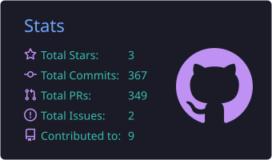
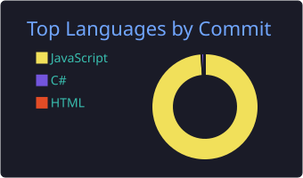

<h1 align="center">Hi, I'm RG 👋</h1>

  <b>BSIT Student · Full-Stack Developer · Game Dev Enthusiast</b> 
  Building scalable, well-architected apps with clean code and great UX.

  
  

---

## 🧑‍💻 About Me

- 🎓 BS Information Technology student at **Bulacan State University – Main Campus**, specializing in **Web and Mobile Development (WMAD)**
- 🌐 Focused on full-stack web development with **React, Firebase, and Node.js**
- 🎮 Building 2D games in **Unity** and currently **learning 3D**
- 📍 Based in San Ildefonso, Bulacan, Philippines
- 🌱 Always learning: clean architecture, CI/CD, and better developer tooling

---

## 🛠️ Tech Stack

**Languages**

**Frontend**

**Backend & Databases**

**Game Development**

**Tools & DevOps**

---

## 🚀 Featured Projects

### 🏢 Asset Management System – CICT

`React` `Vite` `Firebase` `Firestore` `Cloud Functions` · _November 2026_

### 🐸 Frogbound Prince

`Unity 2D` `C#` · _April 2026_

2D game built with a 5-member team, where I worked as **backend scripts developer**.

---

## 🎓 Training & Certifications

**Code Craft: Mastering Essential Tools for Modern Software Development** · _December 2025_
SWITS (CICT Student Organization), Bulacan State University

---

## 📅 Contribution

  <picture>
    <source media="(prefers-color-scheme: dark)" srcset="https://raw.githubusercontent.com/arji-hub/arji-hub/output/github-snake-dark.svg" />
    <source media="(prefers-color-scheme: light)" srcset="https://raw.githubusercontent.com/arji-hub/arji-hub/output/github-snake.svg" />
    
  </picture>

---

## 📊 GitHub Analytics

  
  

  

  

  

---

## 📫 Let's Connect

📧 [rg.gatmaitan23@gmail.com](mailto:rg.gatmaitan23@gmail.com) · 💼 [LinkedIn](https://www.linkedin.com/in/rggatmaitan)

  

